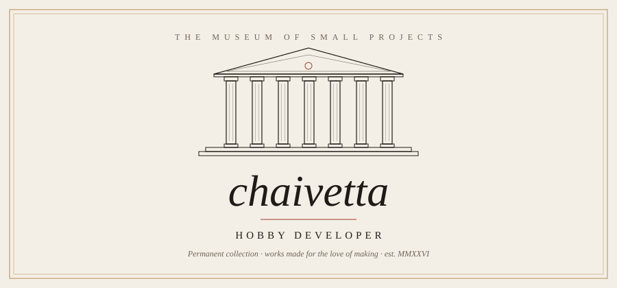

  

<i>
Welcome. Every piece in this collection was made after hours, 
for no client and no deadline — only for the pleasure of making it.
</i>

 

GALLERY I &nbsp;·&nbsp; GAMES &amp; MACHINES

<table>
<tr>
<td width="50%" valign="top">

</td>
<td width="50%" valign="top">

</td>
</tr>
</table>

 

GALLERY II &nbsp;·&nbsp; INSTRUMENTS FOR THE BROWSER

<table>
<tr>
<td width="50%" valign="top">

</td>
<td width="50%" valign="top">

</td>
</tr>
</table>

 

GALLERY III &nbsp;·&nbsp; STUDIES &amp; WORKS IN PROGRESS

<table>
<tr>
<td width="50%" valign="top">

</td>
<td width="50%" valign="top">

</td>
</tr>
</table>

 

  

<i>Paintings: public domain, via Wikimedia Commons — <a href="https://commons.wikimedia.org/wiki/File:Jean-Leon_Gerome_Pollice_Verso.jpg">Gérôme</a> · <a href="https://commons.wikimedia.org/wiki/File:Vincent_van_Gogh_-_Starry_Night_-_Google_Art_Project.jpg">Van Gogh</a> · <a href="https://commons.wikimedia.org/wiki/File:The_Horse_in_Motion_high_res.jpg">Muybridge</a> · <a href="https://commons.wikimedia.org/wiki/File:Michelangelo_-_Creation_of_Adam_(cropped).jpg">Michelangelo</a> · <a href="https://commons.wikimedia.org/wiki/File:Van-willem-vincent-gogh-die-kartoffelesser-03850.jpg">Van Gogh</a> · <a href="https://commons.wikimedia.org/wiki/File:Leonardo_da_Vinci_-_The_Last_Supper_high_res.jpg">Leonardo</a></i>

