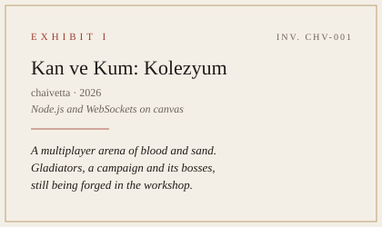
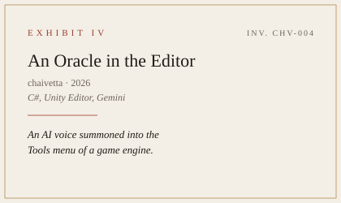
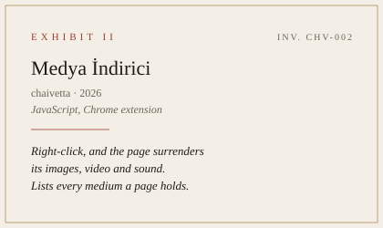
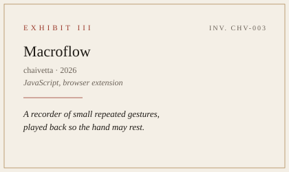
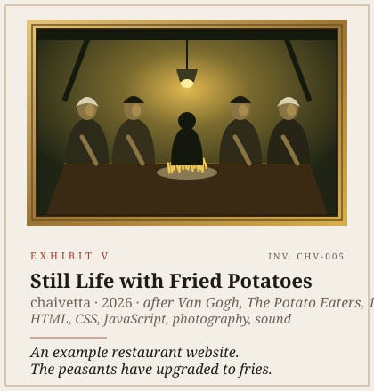
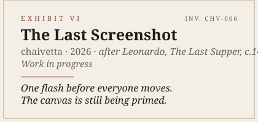
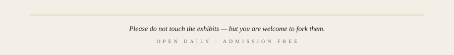

  

<i>
Welcome. Every piece in this collection was made after hours, 
for no client and no deadline — only for the pleasure of making it.
</i>

 

GALLERY I &nbsp;·&nbsp; GAMES &amp; MACHINES

  
  

GALLERY II &nbsp;·&nbsp; INSTRUMENTS FOR THE BROWSER

  
  

GALLERY III &nbsp;·&nbsp; STUDIES &amp; WORKS IN PROGRESS

  
  

 

  

