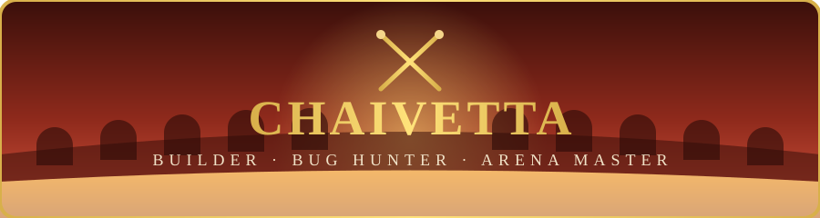

<div align="center">



<br>


</div>

---

### 🏛️ `> enter_arena`

```diff
+ Fixing problems others gave up on.
+ Building games, tools and web experiments.
! Status: in the arena, sword drawn 🗡️
```

<br>

### ⚔️ `> champions`

| | Project | What it does |
| :---: | :--- | :--- |
| 🏟️ | **[Oyun](https://github.com/chaivetta/Oyun)** | *Kan ve Kum* — gladiator arena game: campaign, bosses, skill tree |
| 📥 | **[medya-indirici](https://github.com/chaivetta/medya-indirici)** | Media downloader tool |
| 📸 | **[KairaShot](https://github.com/chaivetta/KairaShot)** | Screenshot / capture utility |
| 🔁 | **[Macroflow](https://github.com/chaivetta/chaivetta-Macroflow-Macro-recorder-browser-extensions.)** | Browser extension that records and replays macros |
| 🤖 | **[unity-gemini-agent-api](https://github.com/chaivetta/unity-gemini-agent-api)** | AI agent inside the Unity editor |
| 🌐 | **[Patata-example-site](https://github.com/chaivetta/Patata-example-site)** | Example website / frontend practice |

<br>

### 🗡️ `> armory`

<div align="center">


</div>

<br>

### 🛡️ `> gladiator_stats`

| Skill | Power | |
| :--- | :--- | ---: |
| ⚔️ **Problem solving** | 🟥🟥🟥🟥🟥🟥🟥🟥🟥⬛ | **92** |
| 🛡️ **Bug hunting** | 🟧🟧🟧🟧🟧🟧🟧🟧🟧⬛ | **88** |
| 🏛️ **Game design** | 🟨🟨🟨🟨🟨🟨🟨🟨⬛⬛ | **80** |
| 🔥 **Creative debugging** | 🟧🟧🟧🟧🟧🟧🟧🟧⬛⬛ | **81** |

---

<div align="center">


<sub>🏛️ *Ave, visitor — those about to code salute you.* 🏛️</sub>

</div>
